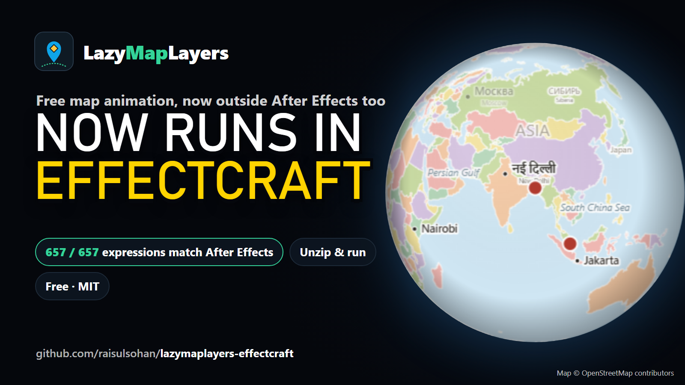

# LazyMapLayers for EffectCraft

<p align="center"><a href="https://github.com/raisulsohan/lazymaplayers-effectcraft/releases/latest"></a></p>

LazyMapLayers (the map design and map animation panel for After Effects) running in
[EffectCraft](https://github.com/storytold/effectcraft), the open-source After Effects-style
compositor written in Rust.

This folder holds only what EffectCraft needs on top of LazyMapLayers. The After Effects version in
`../LazyMapLayers` stays as it is: this version is built from it.

## 🎬 Video tutorials

<p align="center"><strong>Learn LazyMapLayers on YouTube:</strong> <a href="https://youtu.be/FkpwM74xt-s">the complete tutorial</a> shows every tool, and <a href="https://www.youtube.com/playlist?list=PLdM39o5SFdHk">the tutorial playlist</a> has the lessons one by one. They are filmed in After Effects; the panel here is the same, so every tool works the same way in EffectCraft.</p>

<p align="center">
  <a href="https://youtu.be/FkpwM74xt-s"></a>
  <a href="https://www.youtube.com/playlist?list=PLdM39o5SFdHk"></a>
</p>

<p align="center"><a href="https://youtu.be/FkpwM74xt-s"></a></p>

## How it works

EffectCraft has no HTML extension panels (CEP), but it runs After Effects-style scripts and has a
control channel for other programs. So LazyMapLayers runs in two parts, as it does in After Effects:

```
 panel window (Edge or Chrome)          local companion (Node)              EffectCraft
 LazyMapLayers' own panel: preview,  -> app/server.mjs: files, downloads, -> its script engine runs
 maps, renders, everything          <- the host calls                    <- LazyMapLayers' host script
                                                                            (with host/compat.jsx)
```

- **Host.** LazyMapLayers' unchanged host script runs in EffectCraft's script engine, wrapped in a
  compatibility layer (`host/compat.jsx` before it, `host/compat-post.jsx` after it) that fills the
  gaps in EffectCraft's After Effects scripting and expression API (found in 0.8.0; EffectCraft
  0.9.2 and 0.10.0 fixed many of them, see [The compatibility layer](#the-compatibility-layer)).
- **Panel.** LazyMapLayers' own panel, built from its sources with two modules swapped: the CEP
  bridge (`panel/cep.ts`) and the PMTiles file reader (`panel/nodeFileSource.ts`). It opens in an app
  window of Microsoft Edge (InPrivate, so no sign-in or sync) or Google Chrome.
- **Companion.** `app/server.mjs` serves the panel on `127.0.0.1`, answers its file calls, streams
  its downloads, and sends each host call to EffectCraft over EffectCraft's control channel
  (`effectcraft --control 9877`). It starts EffectCraft with the control channel when it is not
  running, and stops when the panel window closes.

## What you need

- **EffectCraft 0.8.0** or newer (0.10.0 or newer recommended: undo, Self-test and selection work as
  in After Effects there), installed (or `EFFECTCRAFT_APP` set to `effectcraft.exe`).
- **Node.js 22** or newer.
- **Microsoft Edge** or **Google Chrome** (for the panel window).

## Install

**From a release (recommended).** Download `LazyMapLayers-for-EffectCraft-<version>.zip` from
[Releases](https://github.com/raisulsohan/lazymaplayers-effectcraft/releases/latest) and unzip it
anywhere. It is ready to run: the panel, the host script and the bundled data are already built.

**From source.** Clone this repository next to
[LazyMapLayers](https://github.com/raisulsohan/LazyMapLayers) (`../LazyMapLayers`) and build that
once (`npm install` and `node tools/build.mjs` in it): its `dist/` holds the host script and the
bundled data, and its `node_modules` the build tools. The first start here builds `dist/` from it.

## Start

1. Close EffectCraft if it is open (it has to start with its control channel).
2. Double-click **`Start LazyMapLayers.cmd`** (macOS and Linux: `./start-lazymaplayers.sh`).
   EffectCraft opens, then the LazyMapLayers panel window. Closing the panel window stops the
   companion; EffectCraft stays open.
3. **Once:** in EffectCraft, **Edit ▸ Preferences ▸ Scripting & Expressions**, turn on **Allow Scripts
   to Write Files and Access Network**. EffectCraft's scripts can otherwise read only the project's
   own folder, and the rendered maps live in LazyMapLayers' data folder. Without it the panel says
   so when a render is imported.

From source, after LazyMapLayers itself changes, build again:

```
node tools/build.mjs
```

## Data

- This version keeps its renders, render queue, drafts and settings in
  `%APPDATA%\LazyMapLayers for EffectCraft` (macOS: `~/Library/Application Support/LazyMapLayers for EffectCraft`).
- The downloads are **shared** with the After Effects version: `offline`, `regions`, `terrain`,
  `history`, `imagery`, `boundaries`, `osm`, `osm-cache` (street detail), `osm-roads` (routes on
  roads), `satellite` and `districts` under this version's data
  folder are read from and written to the After Effects version's data folder
  (`%APPDATA%\LazyMapLayers`). A region or offline pack downloaded in either version is there in both.
  `LMLEC_AE_DATA` points the companion at another folder for them.
- The panel's temporary files (job files, its log, in-app test requests) go to
  `%TEMP%\LazyMapLayers for EffectCraft`, apart from the After Effects version's, so both can run at once.

## What works

LazyMapLayers 1.3.0's own in-app test suites, run in EffectCraft through this version
(`tools/run-suites.mjs`), and every kind of generated expression compared with After Effects' maths
on real EffectCraft layers (`tools/check-expressions.ts`: 657 of 657, in 62 kinds, the arrow rig's and
the borders between areas included). On EffectCraft 0.11.1 the expressions also give 657 of 657 as
LazyMapLayers writes them (`--raw`), without this version's rewrite.

| Suite | What | EffectCraft 0.11.1 | EffectCraft 0.8.0 |
|---|---|---|---|
| H1 | Host API through the bridge, one undo step per action | 9 / 9 | 9 / 9 |
| FB1 | The feature browser, with 1.3's TCX import, lines from a hub and the borders between areas as one shape layer of open paths | pass | pass |
| AR1 | The arrow rig (1.2): line and head on one layer, tapered, dashed, both ends | pass | pass |
| RR1 | Routes on roads (1.2), roads from Overpass, kept on disk | pass | pass |
| SF1 | The Self-test (1.2) | 5 of 5 pass | 4 of 5 pass, one warning (see below) |
| SD1 | Street detail on demand (1.2) | not run | the planet's tiles come through the companion (checked by hand); the suite needs a light pack beside a development build of the After Effects version |
| P1, C1 | Pins and the matched 3D camera against the camera maths | pass | pass |
| E1 | End to end | not run (needs the Paris region) | pass |
| R1 | Renderer, passes, cache, preview proxy over the final render | pass but two frame counts, one frame off (keys on whole frames, see below) | pass but one check |
| LN1, RD1 | A scene made longer; renders on disk | pass | pass |
| G1, G2 | Globe, globe pins | pass | pass |
| AT1, MF1 | Your own layers attached to a place; scale bar, north arrow, graticule | pass | pass |
| RT1, DR1 | Routes, travellers, dashed lines; drawn paths as routes | pass | pass |
| FL1 | Flows: arcs whose widths follow a table of amounts | pass | not run |
| SL1, HL1 | Outlines as shape layers; highlights as their own pass | HL1 pass; SL1 all but its speed check (one outline adds 1,526 ms to a frame, see below) | HL1 pass; SL1 all but its speed check (667 ms) |
| LB2 – LB6 | Label template, keep-out zones, nature names, names inside Paris along their streets, oceans on a globe | LB2, LB3, LB4, LB6 pass; LB5 not run (needs the Paris region) | pass in 1.1.2; LB2 and LB3 select layers by script in a comp that is not open, see below |
| LD1, LD2 | Label designs of your own, with each place's picture | pass | pass |
| FO1, LK1 | A map that follows another; your own looks | pass | pass |
| DT1, DT2, DT3, HT1 | Numbers on the map, categories and years, prisms, heat | pass | pass |
| OW1, WB1, SAT1 | The offline world, cities and roads at zooms 7 – 9, satellite imagery | pass | pass |
| SH1 | The shot list: 601 frames match the camera maths | pass but speed (applying again: 920 ms) | pass but speed |
| DU1 | A copied scene gets its own map | pass | pass but undo |
| ES1 | A Google Earth Studio camera brought in | values as 32-bit floats (see below) | the same |
| ST1 | Generated layers take their colours and fonts from the map's look | pass but the font (Myriad Pro is not installed, see below) | not run |
| X1 | Expressions in both expression engines | none in EffectCraft (see below) | the same |
| S1, S4 | Renderer speed (the panel's renderer, not EffectCraft) | S1: 170 ms a frame at 1080p, 609 ms at 4K; S4 needs the Paris region | 83 ms a frame at 1080p, 268 ms at 4K |

OI1 cannot run in a browser window (see below).

## Known limitations

Checked on EffectCraft 0.11.1; where EffectCraft 0.8.0 is different, it says so. Things the
compatibility layer cannot change; they need EffectCraft itself. The gaps are reported to
EffectCraft as [#808 – #817](https://github.com/storytold/effectcraft/issues?q=is%3Aissue+author%3Araisulsohan)
(details and repros: [docs/effectcraft-issues.md](docs/effectcraft-issues.md)).

- **Undo of large actions** ([#810](https://github.com/storytold/effectcraft/issues/810), **fixed in
  EffectCraft 0.9.2**). From 0.9.2 every action is one undo step, whatever its size, as in After
  Effects. Before 0.9.2, an undo group with more commands than EffectCraft's *Levels of Undo* (32 by
  default, 99 at most) does not become one undo step: only its last steps undo, one by one. Small
  actions (a map, a pin, a view key) are one undo step; labels, flights and shot lists are not.
  Raising **Settings ▸ General ▸ Levels of Undo** to 99 helps up to 98 commands.
- **Keyframe speed.** Each keyframe is one engine command (about 3 ms in the app): applying a long shot
  list takes seconds, not milliseconds. Before EffectCraft 0.10.0, removing keys one by one gets
  slower with every key on the property ([#814](https://github.com/storytold/effectcraft/issues/814),
  fixed in 0.10.0: 0.16 ms a key with 1,000 keys on 0.11.1); this version removes a whole range in one
  command.
- **Keys on whole frames.** EffectCraft puts every keyframe on a frame; After Effects allows keys
  between frames. A key asked for at 3.5 s in a 25 fps comp lands on 3.48 s.
- **Single precision.** LazyMapLayers' ES1 test saw keyframe values stored as 32-bit floats in the app
  (about 5 cm on the ground for a latitude); the generated expressions already allow for it. Keys set
  from `effectcraft-cli` keep full precision, so this may depend on how the app stores them. The
  same on 0.11.1.
- **One expression engine.** EffectCraft runs every expression in its JavaScript engine; there is no
  Legacy ExtendScript engine to choose. LazyMapLayers' expressions run in both, so this changes nothing.
- **Detailed outlines render slowly.** A country outline as a shape layer (many paths, with
  expressions) adds about one and a half seconds to an EffectCraft 0.11.1 frame (SL1: 1,526 ms; 667 ms
  on 0.8.0). A single 20,000-point path without expressions renders in about 18 ms (0.8.0), so it is
  the many paths or their
  expressions.
- **Fonts.** Fonts After Effects carries itself (Myriad Pro and others) are not on the system;
  labels and callouts use the next font in their list that is installed.
- **Replacing a layer's source** ([#813](https://github.com/storytold/effectcraft/issues/813); used
  when a copied scene gets its own map, and for pictures in a label design) is done by putting a new
  layer in the old one's place. Its transform, timing, effects (values, keys, easing, expressions),
  switches, name, comment, parent and children come along; its masks, layer styles and track matte do
  not.
- **Your own imagery test.** LazyMapLayers' OI1 test starts a tile server inside the panel, which a
  browser window cannot; the feature itself (imagery from a server on this computer) uses the
  companion's downloads.
- **Self-test pixels** ([#1000](https://github.com/storytold/effectcraft/issues/1000), **fixed in
  EffectCraft 0.10.0**). The Self-test (Maps ▸ About) checks that After Effects shows the rendered
  frame's colours with `sampleImage()`. EffectCraft 0.10.0 and later sample footage as After Effects
  does, and all five checks pass (checked on 0.11.1). Before 0.10.0, `sampleImage()` gives
  `[0, 0, 0, 0]` on footage: that check is reported as not compared (a warning) instead of failing,
  and the other four checks run as in After Effects.
- **Selection in a comp that is not open** ([#1001](https://github.com/storytold/effectcraft/issues/1001),
  **fixed in EffectCraft 0.10.0**). EffectCraft 0.10.0 and later keep layers selected by a script in
  any comp, and LazyMapLayers' LB2 and LB3 tests pass (checked on 0.11.1). Before 0.10.0, EffectCraft
  keeps them only in the comp open in the viewer. Selecting in the scene you are working in (the usual
  way, for a label template from a text layer or the layers names keep away from) works there too;
  the LB2 and LB3 tests, which select by script in a scene that is not open, do not.

## The compatibility layer

`host/compat.jsx` (before the host script) and `host/compat-post.jsx` (after it). Every fix is
listed in the panel's `ping` (`effectcraft.compat`) and works only in EffectCraft; nothing changes in
After Effects. They use EffectCraft's own engine commands, never its files.

The last column is the first EffectCraft release with the fix (checked on 0.11.1). A fix stays in the
layer while EffectCraft 0.8.0 is supported; on a release that has the fix it does the same as
EffectCraft itself (the Dashes and Path Options names, for one, ask EffectCraft first).

| EffectCraft 0.8.0 | Here | Issue | Fixed in EffectCraft |
|---|---|---|---|
| `Layer.comment` cannot be written (every LazyMapLayers tag lives there) | written with `layer.setComment` | [#808](https://github.com/storytold/effectcraft/issues/808) | 0.9.2 |
| Expressions: `layer.source` is undefined, and a layer reached through a Layer Control has no `transform`; the failing expression silently keeps the property's own value | the expressions LazyMapLayers writes use `layer.width/height` and `layer.scale` (and the inverse of `toComp()` for `fromComp()`) | [#809](https://github.com/storytold/effectcraft/issues/809) | 0.10.0 |
| A new object on every access (`a.containingComp === b.containingComp` is false) | one object per item and layer | [#811](https://github.com/storytold/effectcraft/issues/811) | 0.9.2 |
| Nested undo groups (seen once in the app; one undo step in `effectcraft-cli`) | only the outermost group reaches EffectCraft | |  |
| `app.executeCommand(16)` is not Undo (EffectCraft's own numbering) | After Effects' Undo id is translated | [#812](https://github.com/storytold/effectcraft/issues/812) | 0.9.2 |
| `sourcePointToComp`, `compPointToSource` return the point unchanged | the layer's 2D transform and its parents' | [#808](https://github.com/storytold/effectcraft/issues/808) | 0.10.0 |
| Marker parameters are dropped without a cue point name | kept as a cue point with an empty name | [#808](https://github.com/storytold/effectcraft/issues/808) | 0.9.2 |
| `CompItem.saveFrameToPng` missing | Composition ▸ Save Frame As | [#816](https://github.com/storytold/effectcraft/issues/816) | 0.10.0 |
| Removing a key gets slower with every key (about 40 ms with 1,000 keys) | a whole range in one command | [#814](https://github.com/storytold/effectcraft/issues/814) | 0.10.0 |
| Dashes and text path options have other matchNames | the After Effects names find them | [#815](https://github.com/storytold/effectcraft/issues/815) | 0.9.2 (Path Options), 0.10.0 (Dashes) |
| `AVLayer.replaceSource` "not supported yet" | a new layer in the old one's place | [#813](https://github.com/storytold/effectcraft/issues/813) | open |
| (from the row above) the new layer has a new id, so a copied scene that Undo brought back was separated again | the copy keeps the key it had before | [#813](https://github.com/storytold/effectcraft/issues/813) | open |
| `layer.anchorPoint`, `layer.position`… missing | read from `layer.transform` | [#816](https://github.com/storytold/effectcraft/issues/816) | open |
| `FootageItem.replaceWithSequence`, `setProxyWithSequence`, `setProxyToNone` missing; `proxySource`, `useProxy` fixed stubs; `mainSource.conformFrameRate` has no effect | EffectCraft's Replace Footage, Proxy and Interpret Footage commands; from 0.10.0 EffectCraft's own methods, with only the proxy's `conformFrameRate` added | [#813](https://github.com/storytold/effectcraft/issues/813) | 0.10.0, but for the proxy's `conformFrameRate` |
| No `app.fonts`; a `TextDocument` set by PostScript name reports that name as its family (the text itself renders right) | PostScript names matched to installed families and styles | [#816](https://github.com/storytold/effectcraft/issues/816) | open |
| A pass layer keeps its old anchor point and out point when a render of another size or length replaces its footage | centred and as long as its footage | [#813](https://github.com/storytold/effectcraft/issues/813) | open |
| Errors carry no line number (`e.line`) | the line, from the stack | [#816](https://github.com/storytold/effectcraft/issues/816) | open |
| `sampleImage()` gives `[0, 0, 0, 0]` on footage (the Self-test's pixel check) | no sample reported, so the Self-test warns instead of failing | [#1000](https://github.com/storytold/effectcraft/issues/1000) | 0.10.0 |
| (not EffectCraft's) the page has no Node `zlib`; Overpass answers come gzipped | the companion unpacks answers before the panel sees them | |  |

## Security

- The companion listens on `127.0.0.1` only, accepts only its own `Host`, and every call needs the
  random token written into the page it served: other web pages cannot use it.
- EffectCraft's control channel has no authentication (EffectCraft's own documentation says to turn
  it on only while it is used). It is on while EffectCraft runs from `Start LazyMapLayers`.
- **Allow Scripts to Write Files and Access Network** lets every script you run in EffectCraft do so,
  not only LazyMapLayers.

## For developers

```
node tools/build.mjs [--test]             # dist/; --test turns LazyMapLayers' test automation on
node app/server.mjs [--port 5190] [--control 9877] [--no-launch] [--no-window]
node tools/check-expressions.ts [--per-kind 6] [--raw]   # every generated expression in EffectCraft
node tools/run-suites.mjs 9333 --fresh H1 P1 SH1          # LazyMapLayers' in-app suites (test build,
                                                          # window started with LMLEC_DEBUG_PORT=9333)
node tools/inspect.mjs [--frame "Map Scene" 2 out.png]    # what is in the open project; a rendered frame
node tools/call.mjs listMaps '{}'                          # one host call
node tools/replay.mjs saved-call.js                        # a saved panel call, with its stack
node tools/probe-expressions.ts                            # expression features one by one
```

`tools/ec.ts` finds `effectcraft-cli` (`EFFECTCRAFT_CLI`, then the usual install folders).
